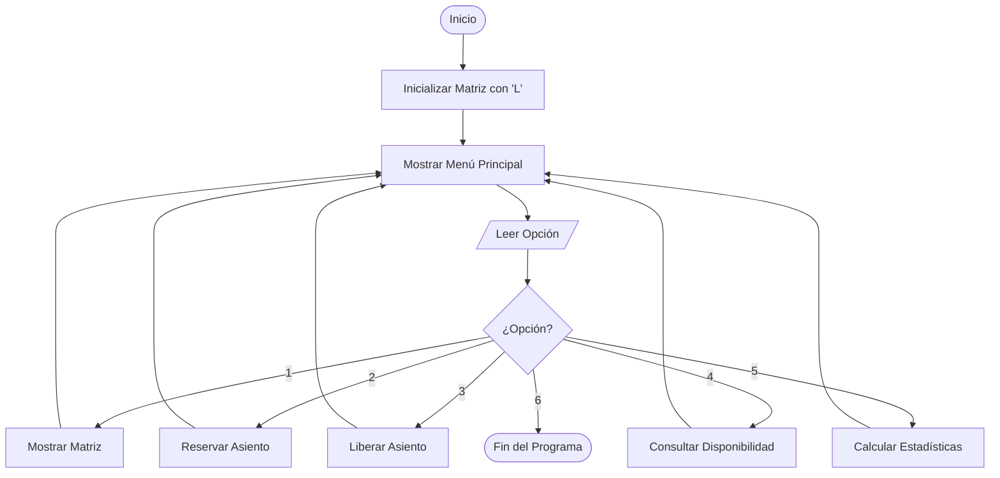
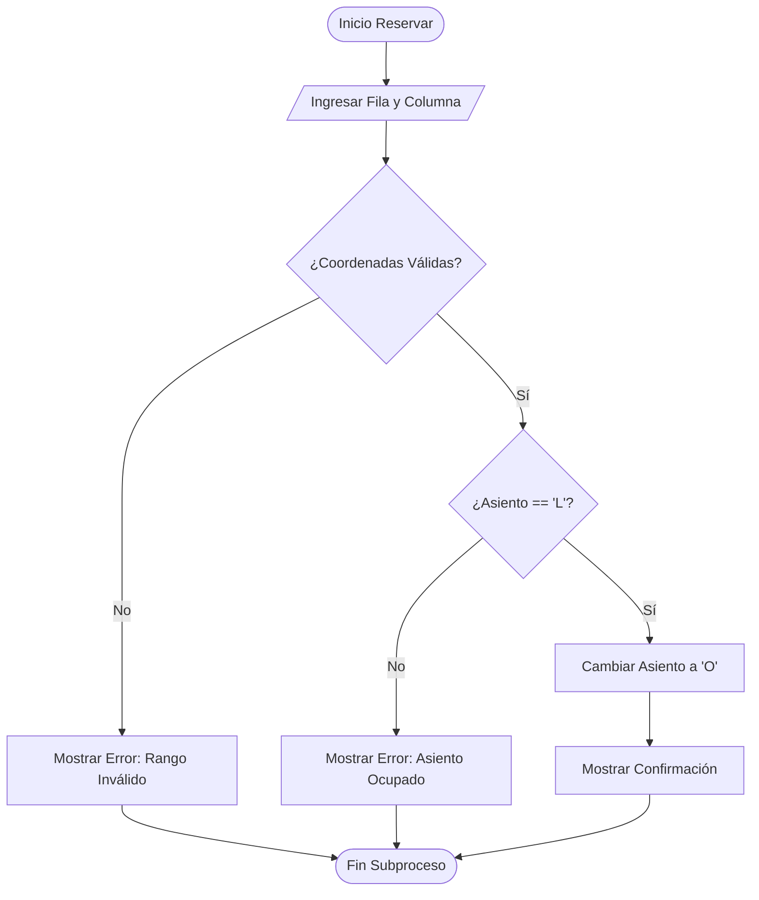

# 📐 DOCUMENTO DE DISEÑO DE LA SOLUCIÓN

**Proyecto:** Sistema de Digitalización y Administración de Asientos de Cine  
**Lenguaje:** C# (.NET 10)  
**Entregable:** Día 2 - Diseño Algorítmico, Pseudocódigo y Diagramas de Flujo  

---

## 1. Algoritmo General del Sistema

```text
Inicio
  1. Declarar Constantes: FILAS = 5, COLUMNAS = 6, LIBRE = 'L', OCUPADO = 'O'
  2. Declarar Matriz: sala[FILAS, COLUMNAS] de tipo Carácter
  3. Ejecutar subproceso InicializarSala()
  4. Repetir:
       a. Mostrar menú principal de opciones
       b. Leer opcion elegida por el usuario
       c. Según opcion hacer:
            Caso 1: Ejecutar MostrarMatriz()
            Caso 2: Ejecutar ReservarAsiento()
            Caso 3: Ejecutar LiberarAsiento()
            Caso 4: Ejecutar ConsultarDisponibilidad()
            Caso 5: Ejecutar MostrarEstadisticas()
            Caso 6: Imprimir "Saliendo del sistema..."
            De Otro Modo: Imprimir "Opción no válida"
     Hasta que opcion sea igual a 6
Fin
```

---

## 2. Diseño Modular (Planeación de Funciones y Procedimientos)

| Nombre del Método | Parámetros | Tipo de Retorno | Descripción / Responsabilidad |
| :--- | :--- | :--- | :--- |
| `InicializarSala()` | Ninguno | `void` | Llena la matriz bidimensional colocando `'L'` en cada posición `[i, j]`. |
| `MostrarMatriz()` | Ninguno | `void` | Recorre e imprime la matriz con encabezados de fila y columna para visualización. |
| `ReservarAsiento()` | Ninguno | `void` | Solicita fila/columna, valida rangos y estado `'L'`, y cambia a `'O'`. |
| `LiberarAsiento()` | Ninguno | `void` | Solicita fila/columna, valida rangos y estado `'O'`, y cambia a `'L'`. |
| `ConsultarDisponibilidad()` | Ninguno | `void` | Solicita fila/columna y muestra si el asiento está Libre u Ocupado sin modificarlo. |
| `MostrarEstadisticas()` | Ninguno | `void` | Cuenta asientos libres/ocupados y calcula el porcentaje de ocupación global. |
| `ValidarCoordenadas(f, c)` | `int fila, int columna` | `bool` | Retorna `true` si la coordenada está dentro del rango $0 \le f < 5$ y $0 \le c < 6$. |

---

## 3. Pseudocódigo Detallado por Módulos

### 3.1 Módulo: `ReservarAsiento()`
```text
SubProceso ReservarAsiento()
  Imprimir "--- RESERVA DE ASIENTO ---"
  Leer Fila
  Leer Columna
  
  Si ValidarCoordenadas(Fila, Columna) = Verdadero Entonces
    Si sala[Fila, Columna] = 'L' Entonces
      sala[Fila, Columna] <- 'O'
      Imprimir "¡Éxito! Asiento reservado correctamente."
    Sino
      Imprimir "Error: El asiento ya se encuentra ocupado."
    FinSi
  Sino
    Imprimir "Error: Coordenadas fuera de rango."
  FinSi
FinSubProceso
```

### 3.2 Módulo: `LiberarAsiento()`
```text
SubProceso LiberarAsiento()
  Imprimir "--- LIBERACIÓN DE ASIENTO ---"
  Leer Fila
  Leer Columna
  
  Si ValidarCoordenadas(Fila, Columna) = Verdadero Entonces
    Si sala[Fila, Columna] = 'O' Entonces
      sala[Fila, Columna] <- 'L'
      Imprimir "¡Éxito! Asiento liberado correctamente."
    Sino
      Imprimir "Advertencia: El asiento ya estaba libre."
    FinSi
  Sino
    Imprimir "Error: Coordenadas fuera de rango."
  FinSi
FinSubProceso
```

### 3.3 Módulo: `MostrarEstadisticas()`
```text
SubProceso MostrarEstadisticas()
  Ocupados <- 0
  Disponibles <- 0
  TotalAsientos <- FILAS * COLUMNAS
  
  Para i <- 0 Hasta FILAS - 1 Hacer
    Para j <- 0 Hasta COLUMNAS - 1 Hacer
      Si sala[i, j] = 'O' Entonces
        Ocupados <- Ocupados + 1
      Sino
        Disponibles <- Disponibles + 1
      FinSi
    FinPara
  FinPara
  
  Porcentaje <- (Ocupados / TotalAsientos) * 100
  
  Imprimir "Total Asientos Ocupados: ", Ocupados
  Imprimir "Total Asientos Disponibles: ", Disponibles
  Imprimir "Porcentaje de Ocupación: ", Porcentaje, "%"
FinSubProceso
```

---

## 4. Diagramas de Flujo

### 4.1 Flujo General del Sistema


### 4.2 Flujo de Reserva de Asiento
