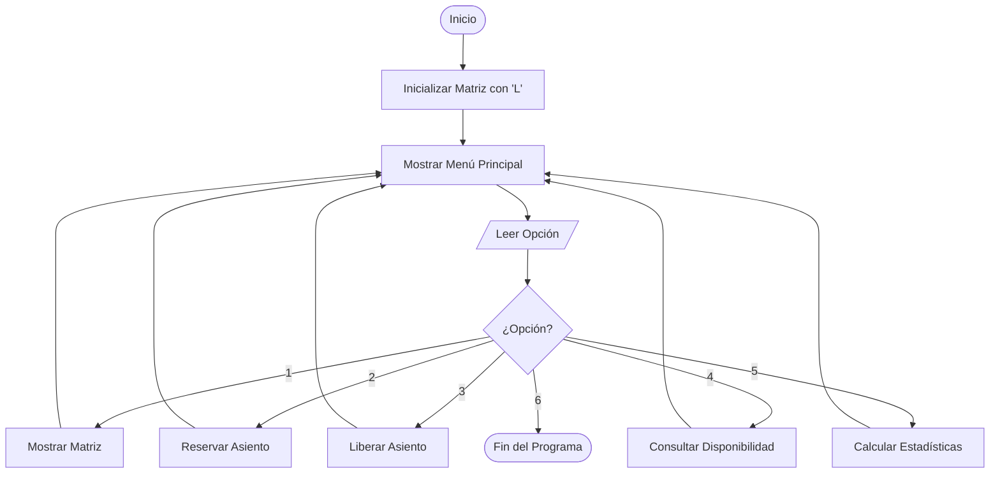

# 📑 DOCUMENTO TÉCNICO DE PRUEBAS Y DOCUMENTACIÓN FINAL

**Proyecto:** Sistema de Digitalización y Administración de Asientos de Cine  
**Lenguaje:** C# (.NET 10) - Aplicación de Consola  
**Entregable:** Día 7 - Pruebas del Sistema y Documentación Final  

---

## 1. Portada e Información del Proyecto

* **Institución:** Instituto Tecnológico / Universidad
* **Asignatura:** Estructura de Datos / Programación
* **Proyecto:** Sistema de Gestión de Sala de Cine
* **Fecha de Entrega:** Día 7

---

## 2. Integrantes del Equipo

* **Integrante 1:** [Nombre del Alumno 1] - *Desarrollo de Lógica y Estructura de Datos*
* **Integrante 2:** [Nombre del Alumno 2] - *Diseño de Interfaz, Documentación y Pruebas*

---

## 3. Introducción

El presente proyecto aborda la automatización del control de reservaciones de asientos en una sala de cine mediante la implementación de una matriz bidimensional en C#. Se describe el proceso desde el análisis formal del problema hasta las pruebas finales y la estructura del sistema.

---

## 4. Planteamiento del Problema

Las salas de cine tradicionales sufren errores en la asignación manual de entradas, generando sobreventa de butacas o inconsistencias en los datos de disponibilidad. Se requiere un sistema automatizado que garantice que un asiento solo pueda estar en un estado válido (**Libre** u **Ocupado**) en todo momento.

---

## 5. Objetivos

* **Objetivo General:** Desarrollar una aplicación de consola modular en C# que gestione en tiempo real la asignación de asientos de una sala de cine mediante una matriz $5 \times 6$.
* **Objetivos Específicos:**
  1. Implementar la inicialización, recorrido y modificación de la matriz `char[,]`.
  2. Capturar reservas y liberaciones con validación estricta de coordenadas y tipos de datos.
  3. Calcular métricas en tiempo real: ocupados, disponibles y porcentaje de ocupación.

---

## 6. Análisis de Entradas, Procesos y Salidas (EPS)

* **Entradas:** Selección de menú (1-6), número de fila ($0-4$), número de columna ($0-5$).
* **Procesos:** Validación de entradas numéricas mediante `int.TryParse`, validación de rangos de matriz, conmutación de estado (`'L'` $\leftrightarrow$ `'O'`), conteo y cálculo porcentual.
* **Salidas:** Matriz visualizada en pantalla, mensajes de confirmación o error, y resumen de estadísticas.

---

## 7. Diseño de la Solución

El sistema se diseñó de forma modular bajo la siguiente arquitectura de métodos en `Program.cs`:
* `InicializarSala()`: Inicializa todas las celdas en `'L'`.
* `MostrarMatriz()`: Despliega la matriz formateada.
* `ReservarAsiento()`: Modifica una celda libre a ocupada.
* `LiberarAsiento()`: Modifica una celda ocupada a libre.
* `ConsultarDisponibilidad()`: Muestra el estado de una celda específica.
* `MostrarEstadisticas()`: Recorre la matriz y reporta el porcentaje global de ocupación.
* `LeerEntero()`: Función auxiliar de validación contra errores de entrada.

---

## 8. Diagramas de Flujo

### Diagrama de Flujo General


---

## 9. Plan y Matriz de Pruebas (Evidencias de Funcionalidad)

| ID | Módulo Probado | Entradas de Prueba | Estado Esperado | Resultado de Ejecución | Estatus |
| :-: | :--- | :--- | :--- | :--- | :-: |
| **P01** | Inicialización | Ejecución inicial | Todas las celdas `[i, j] == 'L'`. | Matriz vacía generada correctamente. | **PASÓ** |
| **P02** | Reserva Exitosa | Fila: `2`, Columna: `3` | Asiento cambia a `[ O ]`. | Confirmación mostrada; celda reservada. | **PASÓ** |
| **P03** | Reserva Duplicada | Fila: `2`, Columna: `3` | Bloqueo por ocupado. | Muestra mensaje de error: "ya se encuentra OCUPADO". | **PASÓ** |
| **P04** | Validar Fila Inválida | Fila: `8`, Columna: `1` | Rechazo de entrada. | Muestra advertencia y solicita reingreso ($0-4$). | **PASÓ** |
| **P05** | Validar Entrada Texto | Fila: `abc`, Columna: `2` | Manejo de excepción. | Evita *crash* y pide número válido. | **PASÓ** |
| **P06** | Liberación Exitosa | Fila: `2`, Columna: `3` | Asiento vuelve a `[ L ]`. | Confirmación de liberación exitosa. | **PASÓ** |
| **P07** | Liberación Redundante| Fila: `2`, Columna: `3` | Notificación de celda libre. | Muestra advertencia: "ya se encuentra LIBRE". | **PASÓ** |
| **P08** | Consulta Estado | Fila: `1`, Columna: `4` | Reportar estado. | Muestra correctamente "LIBRE (Disponible)". | **PASÓ** |
| **P09** | Estadísticas | 6 asientos ocupados | $20.00\%$ Ocupación | 6 Ocupados, 24 Libres, $20.00\%$ Ocupación. | **PASÓ** |

---

## 10. Fragmentos de Código Explicados

### 10.1 Recorrido de Matriz y Cálculo de Estadísticas
```csharp
for (int i = 0; i < FILAS; i++)
{
    for (int j = 0; j < COLUMNAS; j++)
    {
        if (sala[i, j] == OCUPADO)
            ocupados++;
        else
            disponibles++;
    }
}
double porcentajeOcupacion = ((double)ocupados / totalAsientos) * 100;
```
* **Explicación:** Se realiza un doble ciclo anidado de complejidad $O(N \times M)$ recorriendo cada posición de la matriz. Se fuerza un *casting* a `double` en la división para evitar el truncamiento entero al calcular el porcentaje.

### 10.2 Control de Excepciones y Validación de Coordenadas
```csharp
private static int LeerEntero(string mensaje, int min, int max)
{
    int valor;
    while (true)
    {
        Console.Write(mensaje);
        string entrada = Console.ReadLine() ?? "";

        if (int.TryParse(entrada, out valor) && valor >= min && valor <= max)
        {
            return valor;
        }
        Console.WriteLine($"   ⚠️ Entrada inválida. Debe ingresar un número entero entre {min} y {max}.");
    }
}
```
* **Explicación:** Garantiza la robustez del sistema utilizando `int.TryParse`. Si el usuario escribe caracteres alfabéticos o números fuera de límites, la función captura el evento dentro de un bucle hasta obtener un valor válido.

---

## 11. Conclusiones Individuales

* **Integrante 1:** "La implementación de matrices bidimensionales en C# facilita el modelado de distribuciones físicas espaciales como una sala de cine. Aprendí la importancia de aplicar encapsulamiento modular y validaciones sólidas para prevenir que entradas no válidas detengan la ejecución del software."
* **Integrante 2:** "El flujo continuo de trabajo con Git y GitHub permitió mantener un historial ordenado por cada entrega diaria. El diseño previo de la interfaz mediante maquetación en consola mejoró considerablemente la experiencia de uso del sistema final."

---

## 12. Referencias

1. Microsoft. (2026). *Arreglos multidimensionales (Guía de programación de C#)*. Microsoft Learn.
2. Troelsen, A., & Japikse, P. (2022). *Pro C# 10 with .NET 6: Foundational Principles and Practices in Programming*. Apress.